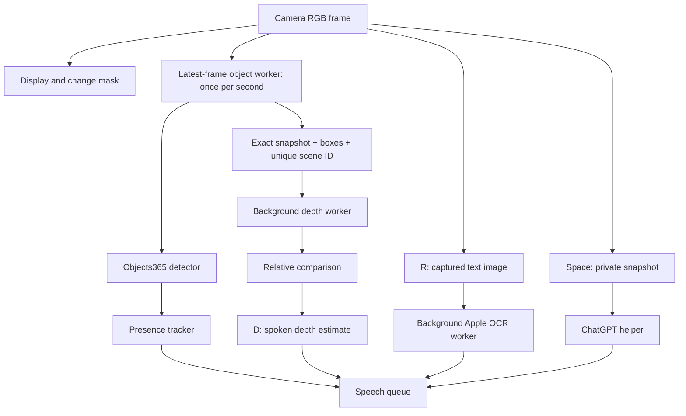

# Learning the VisionAssist codebase

Implementations live in `src/`; matching interfaces live in `include/visionassist/`
using the same feature folders. C++ includes name their feature explicitly, for
example `visionassist/vision/Detector.hpp`. Python is used only for optional cloud
requests/authentication and one-time model preparation.

## Suggested reading order

1. `src/app/main.cpp`: load `config/default.txt` and start the application.
2. `src/app/AppConfig.cpp`: parse shared camera, local-model, and audio settings.
3. `src/app/VisionApplication.cpp`: connect the camera, keyboard, workers, and speech.
4. `src/vision/Detector.cpp`: RGB letterboxing, ONNX inference, categories, boxes,
   per-category suppression, and clock directions relative to the camera.
5. `src/vision/LocalDetectionWorker.cpp`: infer once per second on the latest frame;
   retain immutable source frames and avoid a queue of old camera images.
6. `src/vision/ChangeMask.cpp`: grayscale differences with lighting/motion compensation.
7. `src/vision/PresenceTracker.cpp`: match instances and announce meaningful changes.
8. `src/vision/DepthEstimator.cpp`: run the separate depth model and sample object regions.
9. `src/vision/SceneSummary.cpp`: rank distinguishable depth estimates without claiming meters.
10. `src/text/TextReader.cpp` and `TextReaderApple.mm`: local OCR, confidence filters,
    and a small Objective-C++ bridge to Apple Vision.
11. `src/runtime/SpecialistWorker.cpp`: independent background depth and OCR threads.
12. `src/ui/DisplayRenderer.cpp`: overlays, measured FPS, and absolute-deadline pacing.
13. `src/audio/SpeechQueue.cpp`: serialize voice requests and own the `say` process.
14. `src/ai/ChatGPTClient.cpp`: explicit Spacebar/L actions, cooldown, private snapshots,
    and clean cancellation of Python helpers.
15. `python/smart_vision.py` and `python/chatgpt_auth.py`: cloud requests, sign-in,
    verified identity, refresh, and private session storage.

## Frame flow

## Why snapshot identity matters

Every object result contains its source image, capture time, and publication
sequence. Depth may be combined with boxes only when the scene IDs match and the
capture is less than three seconds old. OCR has its own snapshot, so stale text
boxes are not painted over a moving camera view. Model inference runs off the UI
thread; only the newest pending frames are retained.

## Shared and private settings

- `config/default.txt`: shareable camera, detector, audio, mask, depth, and OCR settings.
- `config/openai.example.conf`: safe AI configuration example; no credentials.
- `.local/openai.conf`: actual AI choices; ignored by Git.
- `.local/openai_api_key`: optional API credential, private permissions.
- `.local/chatgpt/`: sign-in sessions, private directory/files.
- `.local/snapshot.jpg`: latest camera image requested through Spacebar.

The Python helper reads only the private AI settings, never the public settings
file. An environment API key takes precedence over a private inline key or key
file. Relative key-file paths resolve beside `.local/openai.conf`. Relative image
paths resolve from the repository root. C++ does not hold API credentials.

## Models and model tools

The active detector is YOLO26n Objects365 at 640 pixels. Depth uses YOLO26n-depth
at 512 pixels. Runtime exports and provenance live in `models/`; binary weights
are excluded from Git. `tools/models/` prepares and validates them using its own
`.model-tools` environment. The app does not launch Python for local inference.
Apple Vision supplies fast English OCR; `ocr_fast=false` selects accurate mode.

## Tests and publishing

`tests/cpp/` exercises decoding, tracking, refresh scheduling, mask behavior,
speech serialization, specialist isolation, frame identity, and helper cancellation.
`tests/python/` tests authentication and mocked request behavior, including private
configuration separation and relocated image paths. No tests send real cloud requests.

`tools/package_source.py` selects only public source files, checks them for keys
and saved session-token values, and can create a clean source ZIP. It never prints
matched credentials. This complements `.gitignore` when uploading without Git.
